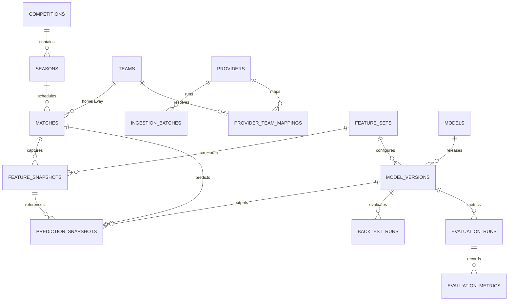

# Database Architecture & Development Guide — Sprint 1.2

## 1. Schema Overview

The **Football Intelligence & Probability Analysis System** database is constructed in PostgreSQL 16 using SQLAlchemy 2.0+ declarative ORM models and Alembic migrations.

The database is divided into six logical entity groups:

```
+-------------------------------------------------------------------------------+
| CORE FOOTBALL DOMAIN ENTITIES                                                  |
| - competitions: Canonical leagues/competitions (code, name, country)          |
| - seasons: Bounded logical seasons (competition_id, season_year, start/end)    |
| - teams: Canonical teams (canonical_name, short_code, country)                |
| - team_alias_mappings: Raw provider aliases -> canonical team resolution       |
| - matches: Canonical fixtures & results (season_id, kickoff, status, scores)  |
| - match_statistics: Match aggregate stats (shots, corners, fouls, provider_xg)|
+-------------------------------------------------------------------------------+

+-------------------------------------------------------------------------------+
| PROVIDER MAPPINGS & RAW INGESTION AUDIT                                       |
| - providers: External provider catalog (football_data_co_uk, live APIs)       |
| - ingestion_batches: Operational batch tracking (status, row_count, checksum) |
| - provider_competition_mappings: External league IDs -> competition_id      |
| - provider_season_mappings: External season IDs -> season_id                  |
| - provider_team_mappings: External team IDs -> team_id                        |
| - provider_match_mappings: External match IDs -> match_id                    |
| - raw_source_records: Raw JSON payload audit ledger for data provenance        |
+-------------------------------------------------------------------------------+

+-------------------------------------------------------------------------------+
| FEATURE ENGINEERING & SNAPSHOTS                                                |
| - feature_definitions: Catalog of calculated statistical features              |
| - feature_sets: Versioned collections of features used by models              |
| - feature_set_features: Junction table defining feature set composition        |
| - feature_snapshots: Immutable pre-match feature vectors (JSONB payload)      |
+-------------------------------------------------------------------------------+

+-------------------------------------------------------------------------------+
| MODEL REGISTRY & LIFECYCLE                                                    |
| - models: Logical model catalog (Elo, Basic Poisson, Enhanced Poisson)        |
| - model_versions: Versioned model artifacts (hyperparameters, lifecycle)      |
| - model_lifecycle_history: Audit history of status transitions                |
+-------------------------------------------------------------------------------+

+-------------------------------------------------------------------------------+
| PREDICTION SNAPSHOT LEDGER                                                    |
| - prediction_snapshots: Immutable pre-match probability predictions (1X2, xG)  |
+-------------------------------------------------------------------------------+

+-------------------------------------------------------------------------------+
| BACKTESTING, EVALUATION & DATA QUALITY                                         |
| - backtest_runs: Chronological backtest execution metadata                    |
| - evaluation_runs: Model performance evaluation runs                          |
| - evaluation_metrics: Key-value metric store (Brier score, Log Loss, ECE)     |
| - data_quality_logs: Integrity, completeness, and quality warning logs         |
+-------------------------------------------------------------------------------+
```

---

## 2. Key Architectural Principles

### Primary Key Strategy
All primary keys across all canonical tables use **UUID v4 (`uuid.uuid4`)**. External provider IDs (e.g. Football-Data `E0`, `2023`) are stored strictly in `provider_*_mappings` tables.

### Probability Precision & Constraints
Outcome probabilities (`prob_home_win`, `prob_draw`, `prob_away_win`) are persisted using PostgreSQL `NUMERIC(6,5)` to eliminate IEEE-754 floating-point inaccuracy. Hard database check constraints enforce:
1. $0.0 \le p_j \le 1.0$ for all individual probabilities.
2. $\left|\sum p_{1X2} - 1.0\right| \le 0.01$ (Exact unity constraint).

### Prediction Snapshot Immutability
`prediction_snapshots` and `feature_snapshots` are append-only. Overwriting existing historical predictions is prohibited. In rare cases where data corrections occur, new predictions reference `supersedes_prediction_id` with an explicit `correction_reason`.

### Data Leakage Guard Design
All feature calculations query historical match data strictly bounded by:
$$\text{WHERE kickoff\_utc} < \text{cutoff\_timestamp}$$

---

## 3. Entity Relationship Diagram (Mermaid)



---

## 4. Prediction Reproducibility Chain

Every prediction output generated by the system can be fully traced back to its raw historical source:

```
[ PredictionSnapshot ]
       │ (model_version_id)
       ▼
[ ModelVersion ] (Code version & hyperparameters)
       │ (feature_set_id)
       ▼
[ FeatureSnapshot ]
       │ (cutoff_timestamp)
       ▼
[ Historical Match Records ] (WHERE kickoff_utc < cutoff_timestamp)
       │ (provider_match_mapping)
       ▼
[ RawSourceRecord / IngestionBatch ]
```

---

## 5. Developer Database Workflows

### Running Migrations
```bash
cd backend
# Generate static SQL preview without database connection
..\.venv\Scripts\alembic.exe upgrade head --sql

# Execute migrations on active database
..\.venv\Scripts\alembic.exe upgrade head
```

### Local Database Reset (Development Only)
```bash
# Drop all tables and re-apply migrations
python scripts/reset_db.py
```

### Seeding Development Test Fixtures
```bash
# Populate 1 provider, 1 competition, 1 season, 2 teams, 1 match
python scripts/seed_dev_db.py
```
